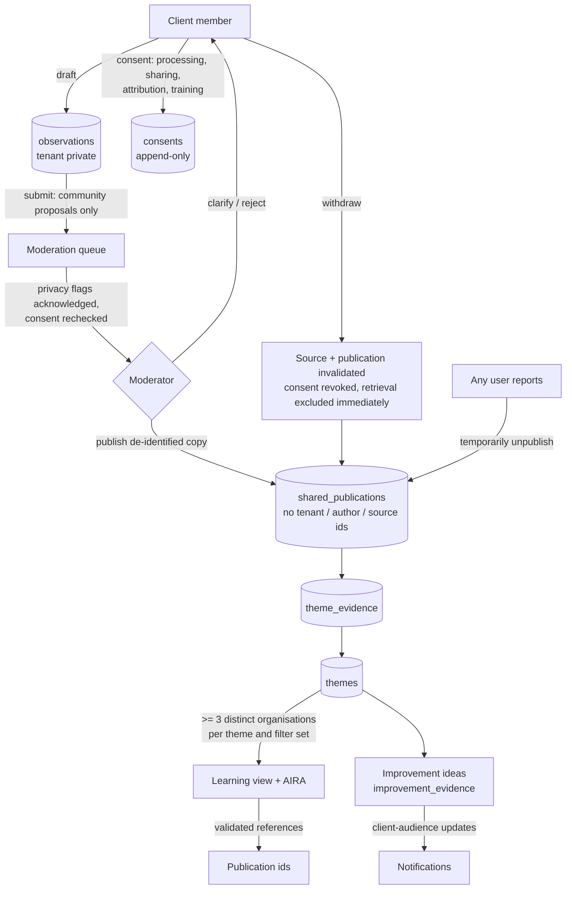

# Architecture

## System overview

```mermaid
flowchart LR
  V[Public visitor] -->|/ /products /connect /hackathon/register| PUB[Public pages]
  PUB --> PF[/api/public-form<br/>rate limit + idempotency/]
  PUB --> PC[/api/public-content<br/>published public items only/]

  U[Signed-in user] --> LOGIN[/login]
  LOGIN --> S[/api/session<br/>membership id only/]
  S -->|verify membership belongs to user + active| M[(memberships)]
  S -->|opaque HttpOnly cookie| SESS[(sessions)]

  U --> APP[Portal UI]
  APP --> API[/api/portal<br/>zod validation + RBAC/]
  API --> SVC[Service layer<br/>lib/services]
  SVC --> DOM[Domain rules<br/>RBAC, workflow map, visibility,<br/>privacy scan, AIRA]
  SVC --> DB[(Cloudflare D1)]
  PF --> DB
  PC --> DB
```

## Learning loop and data separation



## Access model

| Role | Kind | Granted by | Can |
| --- | --- | --- | --- |
| client_admin | client | demo provisioning / invitation | everything a member can, plus invite/revoke client members and grant support access |
| client_member | client | demo provisioning / invitation | author and withdraw own observations, read learning, run entitled sandbox |
| moderator | moderator | staff allow-list | review queue, author themes, resolve reports; private source only via queue or client grant |
| product_owner | product_owner | staff allow-list | improvements, entitlements, content |
| employee | employee | staff allow-list | lab, employee-audience content, playground |
| content_publisher | employee | staff allow-list | publish content by audience |

Every request resolves the actor from the session's membership row; tenant ids in request bodies are never trusted.

## Code map

- `db/schema.ts`, `drizzle/` — tables and generated migrations
- `lib/domain/` — pure rules (RBAC, workflow transitions, visibility, privacy scan, AIRA, schemas)
- `lib/services/` — database operations taking an explicit `db` and `actor`
- `app/api/*` — thin HTTP wrappers (validation, session, error mapping)
- `components/portal-app.tsx` — UI
- `tests/` — Vitest unit + SQLite-backed acceptance tests; `e2e/` — Playwright
